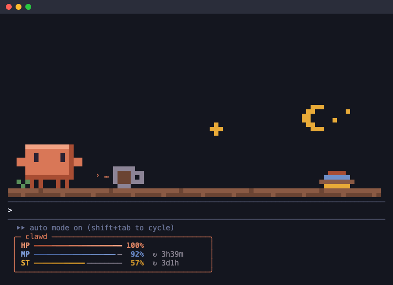

<h1 align="center">clawd-pet</h1>

<p align="center">
  Clawd lives above your Claude Code prompt and acts out every tool call as it happens.<br>
  Below the prompt, a small HUD tracks the context window and your rate limits.
</p>

<p align="center">
  <a href="LICENSE"></a>
  
</p>

<p align="center">
  
</p>

## Install

Requires Claude Code v2.1.287 or newer (check with `claude --version`).

```bash
claude plugin marketplace add Brandon-35/clawd-pet
claude plugin install clawd-pet@clawd-pet
```

Open a new session, or run `/reload-plugins` in the one you have. Clawd shows up above the prompt.

Remove it with `claude plugin uninstall clawd-pet@clawd-pet`.

## What Clawd does

Clawd is a clay-colored block with slit eyes, two stubby arms, and four short legs. It never changes shape; it lifts its arms, steps its legs, and hops.

| What happens in the session | What Clawd does |
| --- | --- |
| Nothing | Stands, blinks, glances around, waves now and then. Dozes off after the **Sleep after** time (one minute unless you change it). |
| You send a prompt | Hops, arms up |
| A tool call finishes | Trots back and forth across the band for 4 seconds, leaping anything in its way |
| Claude is thinking | Taps its chin, with dots rising beside it |
| `Read` | Holds an open book: `reading app.ts` |
| `Grep`, `Glob` | Pans a lens over a page: `looking for "useState"` |
| `Edit`, `MultiEdit`, `Write`, `NotebookEdit`, `TodoWrite` | Writes on a card with a pencil: `editing app.ts` |
| `Bash`, and any other tool | Watches a tiny terminal: `$ npm test` |
| `WebFetch`, `WebSearch` | Turns a globe with a satellite: `fetching docs.anthropic.com` |
| A subagent starts | Lights a bulb. A small Clawd joins the line behind it until that subagent is done, then pops off with a sparkle, or greys out if it failed. |
| A tool call fails | Dizzy eyes and stars |
| The turn ends with an answer | Cheers and hops |
| You stop the turn (Esc) | Sad eyes: `okay, stopping` |
| The turn ends in an error or a refusal | Dizzy eyes, like a failed tool call |
| The conversation compacts | Spiral eyes while it packs up the context |
| Claude Code needs you (a permission prompt or any other notification) | A blinking gold `!` and `you’re needed`, until you answer |

The status line beside Clawd names what each tool works on. Turn that off with the **Name files and commands** setting when you share your screen.

Once a turn has run for five seconds, the status line also shows how long: `thinking · 1m 05s`. While Claude Code waits on you, it shows how long you have kept it waiting.

## Toasts and `/clawd`

Clawd speaks up in a toast when something needs your eyes:

| When | Toast |
| --- | --- |
| A turn of 30 seconds or more ends | `done in 2m 14s · 18 tool calls · 3 files edited · 1 failed · $0.42`, or that it ended in an error |
| Three tool calls fail in a row (and every three after) | `3 tool calls failed in a row. Press Esc to step in if Claude is stuck.` |
| The same command, search, or fetch runs a third time with no edit between | `` `$ npm test` ran 3 times with no edit between. Claude may be going in circles. `` |
| Context left falls to 20 %, then to 10 % | `context 18% left (about 3 turns at this pace): run /compact at a good stopping point` |
| The 5-hour or 7-day limit falls to 10 % | `5-hour limit 8% left, resets in 1h12m` |
| A limit's pace will run it out before it resets | `at this pace the 5-hour limit runs out in about 40m, before it resets in 2h10m` |
| One tool result adds 10k tokens or more to the context | `Read big.log added ~14k tokens to the context; Read with offset/limit or Grep to take less` |
| A file is read again, unchanged on disk and still in context | `app.ts is already in context, unchanged since it was read 3 turns ago (~4.2k tokens)` |
| A compaction ends | `compacted 152k → 31k tokens, freed 121k (HP 24% → 84%)` |
| A turn edits two or more code files and runs no test, type check, lint or build | `edited 3 code files this turn and ran no tests or checks` |

Each gauge warns once on the way down, and again only if it climbs back first. The pace warning needs 15 minutes of readings for the 5-hour limit and 2 hours for the 7-day one, and warns once per window. An edit between two identical calls starts their count over, so running the tests after each fix does not warn. A turn you stop yourself ends quietly. The **Toasts** setting turns all of these off.

A turn of two minutes or more also ends with a desktop notification carrying the same recap, through the notification channel you chose in Claude Code, for when you have looked away. Change the wait or turn it off with the **Notify after** setting.

Run `/clawd` at any time, even mid-turn, for a report on the session so far:

```text
report on this session, 1h 02m in:
- 14 turns, 23m 10s of work
- 182 tool calls: 60 read, 40 search, 30 edit, 45 bash, 5 web, 2 agent
- 7 failed (4%)
- 12 files edited
- context 64% left (about 9 turns at this pace) · 5-hour limit 80% left, resets in 2h10m
- cost: $4.10 this session, $0.42 last turn
- compactions: 1, freed ~121k tokens
- heaviest results: Read big.log ~14k · Bash npm test ~11k
- today, in every session: 3 sessions, 41 turns, 1h 52m of work, 520 tool calls, $9.80 spent
- context: messages 98k · system tools 22k · MCP tools 14k · memory files 8k
- biggest MCP servers: github ~9k · figma ~4k
```

The last lines say what fills the context window, so you know what to trim: they come from Claude Code's local estimate, which sends no request. A line shows only when it has something to say. A failed call is one that ran and returned an error; a call you deny does not count. The session counts start over with each session; the last line adds up the whole local day across sessions. The context forecast follows the last few turns and starts over after a compaction; a limit runs out "at this pace" only when that comes before its reset.

Run `/clawd peers` for your other live Claude Code sessions on this machine, the ones waiting on you first:

```text
- clawd-pet · ✻ needs you · HP 41% · ~/code/clawd-pet
- api · running npm test · 3m 05s · HP 72% · ~/code/api
- docs · idle · HP 90% · ~/code/docs
```

It reads the files each session writes for the zsh prompt, so it sees only sessions with **Shell status** on. Plain `/clawd` adds one line, `- peers: 3 live, 1 needs you`, when any is live. Every 10 seconds the mod also checks them: a toast says when one finishes a turn of 30 seconds or more (`✻ api finished (3m 05s)`) or starts waiting on you (`✻ api needs you`), and the HUD's top edge counts the ones waiting (`✻ 1 waiting · $1.24`). The **Peer board** setting turns all of it off.

Run `/clawd send <session> <message>` to message one of them without spending a turn here:

```text
/clawd send api the migration is merged, rebase before you push
sent to api
```

Type `#` after `/clawd send ` or `/clawd note ` to pick the session from a list that shows each one's folder and state; type part of a name or path to narrow it. You can also name the session as `/clawd peers` does, the start of that name, or `#` and the first 4 characters of its id when two share a folder. It needs **Peer board** on. The other session's model reads the message, so it costs that session a turn, not this one.

Run `/clawd note <session> <note>` to leave a note for the person at that session instead. Their clawd-pet takes it before the model sees it: it shows as a toast (`✎ note from web: lunch at 12`) and in their `/clawd`, and costs no tokens on either side. It goes only to a session whose clawd-pet reads notes; an older one gets a refusal here, so the note never reaches its model.

A message another session sends here, which this model will read, toasts with its sender (`✉ api: the migration is merged`) when **Toasts** is on.

## The HUD

A rounded window under the prompt, titled with the pet's name:

```text
╭─ clawd ─────────────────────────── ✻ 1 waiting · $4.10 ─╮
│ HP ━━━━━━━━━━━━━╸──────  64%  72k/200k · ~9 turns       │
│ MP ━━━━╸───────────────  22%  ↻ 2h10m · ⚠ out 40m       │
│ ST ━━━━━━━━━━━━━━━━━━╸─  92%  ↻ 6d12h                   │
╰─────────────────────────────────────────────────────────╯
```

- **HP** is how much of the context window is left, with the tokens used and the turns it holds at the recent pace. The bar goes amber at 50 % and red at 25 %; under 10 % it suggests `/compact`.
- **MP** is what's left of the 5-hour rate limit, and `↻` is the time until it resets. `⚠ out` in amber says when it runs out at this pace, shown only when that comes first.
- **ST** is the same for the 7-day limit.

The top edge carries the session's cost and how many of your other sessions wait on you. Readings arrive as Claude Code measures the session. Set **HUD style** to `line` for one unframed row instead, which saves four rows:

```text
HP ━━━━━─── 64% · MP ━━────── 22% ↻2h10m ⚠40m · ST ━━━━━━━╸ 92% · $4.10
```

Bars fill in half cells and shrink on a narrow terminal. MP and ST go red under 15 %, and appear on Pro and Max plans once a response has reported the limit.

Clawd watches the HUD too: while idle or thinking it sweats at 50 % HP, goes dizzy at 25 %, and looks worn out when MP or ST drops under 20 %.

## In your zsh prompt

Each session writes what it is doing to `~/.cache/clawd-pet/sessions/`. The Oh My Zsh plugin in [`zsh/`](zsh/clawd-pet.plugin.zsh) shows it in your prompt, so a shell in another pane or tab knows when Claude is done or needs you:

```text
~/app  main ✓                           ✻ $ npm test · 1m05s · HP 64%  ✻ 1 waiting
```

The segment shows the session running in the current directory (or a folder above it): its status line, how long the turn has run, and the context left, in the pet's line color. `✻ 1 waiting` counts the other sessions waiting on you. Reading the files takes zsh builtins only, about 0.2 ms a prompt.

1. Link the plugin into Oh My Zsh, from a clone of this repo:

   ```bash
   ln -s "$PWD/zsh" "${ZSH_CUSTOM:-$HOME/.oh-my-zsh/custom}/plugins/clawd-pet"
   ```

2. Add `clawd-pet` to `plugins=(...)` in `~/.zshrc`.
3. With powerlevel10k, add `clawd_pet` to `POWERLEVEL9K_RIGHT_PROMPT_ELEMENTS` in `~/.p10k.zsh`. With any other theme, add `RPROMPT='$(clawd_pet_prompt_info)'` to `~/.zshrc`.
4. Open a new shell.

Two commands come with it:

- `clawd-status` lists every live session: mode, directory, status line, HP, MP.
- `clawd-wait` waits until the session here stops working, rings the bell, and fails if the turn failed or was stopped: `clawd-wait && git push`.

Set `CLAWD_PET_ICON` or `CLAWD_PET_MAX` (the most status-line characters shown, 28 by default) before the plugin loads to change the look. Turn the files off with the **Shell status** setting.

## Customize

Ask Claude in any session, or run `/clawd-pet:clawd-pet`. Some things to try:

- "make Clawd teal", or "draw me a pet frog instead";
- "give it a coffee mug when it runs commands", "drop the thinking dots";
- "make the subagent minis tiny frogs";
- "write pirate status lines", "make the bash line green";
- "a purple HUD frame", "call HP FUEL", "hide ST";
- "a beach with crabs to jump over";
- any of the settings below.

Claude first opens a preview page with every motion, face, status line, and HUD state, plus the pet running through its scene on a dark and a light background. Ask for changes until it looks right. Once you approve, it replaces the pet on screen right away and is kept for future sessions. Ask for Clawd back to undo.

Everything except the settings lives in one theme, a JSON object described in [`FORMAT.md`](plugins/clawd-pet/skills/clawd-pet/FORMAT.md). Clawd's own theme, [`clawd.json`](plugins/clawd-pet/assets/clawd.json), uses nearly every field and is the best starting point. Ask Claude to save your theme as a file to share it, or to load a file someone sent you.

## Settings

Run `/plugin configure clawd-pet@clawd-pet` in a session.

| Setting | Default | Effect |
| --- | --- | --- |
| Speed | `normal` | Animation and running speed: `slow`, `normal`, or `fast`. |
| Sleep after (seconds) | `60` | Idle time before Clawd sleeps. `0` keeps it awake. |
| HUD | on | The HP, MP, and ST window below the prompt. |
| HUD style | `window` | `window`: the framed HUD with token counts, forecasts, and the session's cost. `line`: one unframed row, four rows shorter, for a small terminal. |
| Status line | on | The text beside the pet. |
| Name files and commands | on | Show the file, pattern, command, host, or query each tool works on. |
| Subagent minis | on | One mini per running subagent behind the pet. |
| Toasts | on | The recap after a long turn, the warnings for failing or repeated calls, low context, and low or fast-falling rate limits, and the messages and notes other sessions send. |
| Shell status | on | Write each session's state to `~/.cache/clawd-pet/sessions/` for the zsh prompt. |
| Peer board | on | `/clawd peers` lists your other live sessions on this machine, read from those files; a toast says when one finishes a long turn or waits on you, and the HUD counts the waiting. |
| Notify after (seconds) | `120` | A turn at least this long ends with a desktop notification. `0` turns it off; under `30` counts as `30`. |

Or from a shell, then restart Claude Code:

```bash
echo '{"speed": "fast", "sleepAfter": "300"}' | claude plugin configure clawd-pet@clawd-pet --values-stdin
```

The install may say "11 userConfig options not yet set". Every setting has a default, so nothing is needed.

## Update

```bash
claude plugin marketplace update clawd-pet
claude plugin update clawd-pet@clawd-pet
```

Start a new session afterwards. Your theme and settings are kept.

## Where it shows

Clawd is drawn with colored text cells, so any terminal with 24-bit color works. The Desktop app's Code tab draws it as SVG. It does not appear in the VS Code chat panel, in `claude -p`, or in cloud sessions. The HUD is terminal only.

## Privacy and security

A mod runs inside Claude Code with your permissions. clawd-pet:

- reads its own theme, polls session usage and the subagent list, and draws;
- registers the `/clawd` command, which prints counts it keeps in memory for the session;
- keeps the day's totals (sessions, turns, time worked, tool calls, compactions, spend) in its own store, as numbers only;
- reads each tool result's size as it enters the conversation, to warn about heavy ones, and never changes it; the size, tool and target are kept in memory for the report;
- checks a file's modified time when Claude reads it again, to tell an unchanged re-read; the paths it remembers live in memory until the next edit or compaction;
- asks Claude Code for its local context estimate when you run `/clawd`, which sends no request;
- sends a desktop notification through Claude Code when a long turn ends, if **Notify after** is not `0`;
- registers three tools for themes: `get_theme` returns the current theme, `preview_theme` writes a preview page to the path Claude gives it, and `set_theme` stores a theme in the mod's own store;
- writes one small file per session to `~/.cache/clawd-pet/sessions/` for the zsh prompt, unless **Shell status** is off: the mode, line color, status line, session folder, HP, MP, ST, and timestamps;
- reads the other sessions' files in that folder for `/clawd peers`, its toasts and the HUD's waiting count, unless **Peer board** is off: it shows them and never acts on their text;
- sends `/clawd send` messages only to your own live sessions on this machine found in those files, over Claude Code's local channel, with no network, and `/clawd note` notes the same way;
- keeps the last 3 notes other sessions sent in memory only, never on disk, and shows them as text without acting on them;
- makes no network requests and starts no processes, and reads one environment variable, `HOME`, to find that folder.

The zsh plugin reads those files with zsh builtins and deletes ones a dead session left for a day; it starts no process either.

Its tool hook sees each tool's input but keeps only a short target for the status line: for `Bash`, the command's first line cut to 24 characters. For `/clawd` it also keeps the paths of edited files, in memory only, to count each file once; the report prints the count, never the paths. To spot repeated calls it keeps, in memory and only until the next edit, each call's command, path, pattern, URL, or query. The turn hooks read only when a turn starts and ends, how long it took, and why it ended. The notification hook only notes that a notification arrived and whether a plugin sent it; it never reads the text.

To check, run `claude plugin validate plugins/clawd-pet` on a clone. Its `calls:` line lists every Claude Code API the mod uses.

Report a vulnerability through a [private security advisory](https://github.com/Brandon-35/clawd-pet/security/advisories/new).

## Development

```text
.claude-plugin/marketplace.json   marketplace with the one plugin
plugins/clawd-pet/
  .claude-plugin/plugin.json      name, version, settings
  hooks/hooks.json                points Claude Code at register.tsx
  hooks/register.tsx              connects Claude Code events to the modules, serves the theme tools
  hooks/anim.ts                   picks the pet's next mode on each tick, and when it leaps
  hooks/pixels.ts                 draws a frame: body, eyes, props, effects, minis
  hooks/theme.ts                  reads a theme and poses its sprite into every clip
  hooks/scene.ts                  lays out and draws the scene
  hooks/preview.ts                writes the preview page
  hooks/status.ts                 the status line
  hooks/hud.ts                    the HUD window and its bars
  hooks/minis.ts                  one mini per subagent
  hooks/settings.ts               reads the settings
  hooks/*.test.ts                 tests, one file per module
  types/index.d.ts                the mod's state contract
  assets/clawd.json               Clawd's theme
  skills/clawd-pet/               the theme skill and FORMAT.md
scripts/build-clawd-assets.mjs    writes assets/clawd.json
tools/preview/build.mjs           writes the preview for a theme file
tools/demo/record.mjs             records docs/images/demo.gif
```

Run your working copy with `claude --plugin-dir ./plugins/clawd-pet`; saving a file reloads the mod. Before a pull request:

```bash
claude plugin validate . --strict
claude plugin validate plugins/clawd-pet --strict
claude plugin test plugins/clawd-pet
```

`tsc -p plugins/clawd-pet` type-checks the mod once one `--plugin-dir` session has written `plugins/clawd-pet/.claude-plugin/types/`. The tests don't need it.

- `node scripts/build-clawd-assets.mjs` redraws Clawd after you change its layout or palette.
- `node tools/preview/build.mjs [theme file]` (Node 22.18+) writes `tools/preview/preview.html` for Clawd or the given theme.
- `node tools/demo/record.mjs` (Node 22.18+, Google Chrome or `CHROME`, and `ffmpeg`) re-records the demo GIF.

Installed copies update only when `version` in `plugins/clawd-pet/.claude-plugin/plugin.json` changes. Contributor rules are in [`CLAUDE.md`](CLAUDE.md).

## License

[MIT](LICENSE)
